# AI Builder Intelligence Platform

## Product Thesis

Build a market intelligence web app for AI builders that turns fragmented web signals into product, infrastructure, and investment opportunities. The product should outperform simple news readers by synthesizing across source types instead of only aggregating links.

## Positioning

**Working positioning line:** A market intelligence dashboard for AI builders that turns fragmented web signals into product and infrastructure opportunities.

**Core differentiation:**
- Cross-source synthesis across news, engineering blogs, papers, GitHub repos, product launches, and docs or pricing changes.
- Technical relevance scoring instead of generic popularity ranking.
- Opportunity generation that converts signals into actionable hypotheses.

## Target Users

### Primary users
- AI founders looking for startup wedges and underserved workflows.
- Infra and platform engineers tracking model, tooling, and deployment changes.
- Product and strategy teams monitoring competitive moves and whitespace.

### Secondary users
- VC and research teams running thematic market scans.
- Solo operators building a personal AI research cockpit.

## Product Goals

### V1 goals
- Aggregate high-signal content from 50 to 100 curated sources.
- Cluster related items into coherent topics instead of showing isolated links.
- Track key companies, labs, and research themes over time.
- Surface opportunity candidates with evidence and scoring.
- Make ingestion reliable and reprocessable without needing repeated crawls.

### Non-goals for V1
- Full web-scale crawling.
- General-purpose consumer news reading.
- Social network monitoring across every platform.
- End-user collaboration suites beyond lightweight saved views and notes.
- Fully autonomous recommendations without transparent evidence.

## Core Views

### 1. Live Feed

**Purpose:** Show the latest meaningful signals across all source types with enough context to act on them quickly.

**V1 features:**
- Unified feed of deduped signal cards.
- Filters by source type, topic, entity, and time window.
- Signal card metadata: source, publish time, entities, cluster, and significance score.
- "Why this matters" summary focused on technical and market impact.
- Related links section connecting papers, repos, launches, and docs changes.
- Save to tracker or opportunity board.

**User value:** Fast situational awareness without losing technical depth.

### 2. Topic Clusters

**Purpose:** Group related signals into evolving themes so users can follow a topic instead of reading every document separately.

**V1 features:**
- Auto-generated topic clusters with title, summary, and timeline.
- Cluster evidence panel showing linked source items.
- Entity graph for major companies, tools, models, and researchers in the cluster.
- Velocity indicator showing whether the topic is accelerating or fading.
- Tags such as `LLM infra`, `AI coding`, `agent tooling`, or `open-source serving`.

**User value:** Understand macro movement and avoid duplicate reading.

### 3. Company and Research Trackers

**Purpose:** Monitor specific labs, vendors, repos, product categories, or research themes.

**V1 features:**
- Trackers for companies, model families, repos, papers, and themes.
- Tracker dashboard with latest changes, linked clusters, and activity history.
- Alerts-ready event stream, even if push notifications ship later.
- Quick-add from feed cards and clusters.
- Coverage view showing which sources mention the tracked entity most often.

**User value:** Turn passive reading into active monitoring for the topics that matter.

### 4. Opportunities Board

**Purpose:** Translate weak signals into explicit market or product hypotheses.

**V1 features:**
- Opportunity cards generated from clustered evidence.
- Opportunity types:
  - New startup wedge
  - Underserved workflow
  - Emerging infra bottleneck
  - Tooling consolidation opportunity
  - Pricing or business model disruption
- Evidence bundle for each card with supporting sources and extracted pain points.
- Opportunity score with interpretable factors.
- Workflow states: `new`, `reviewing`, `validated`, `parked`.
- Analyst note field for human refinement.

**User value:** The product does not stop at awareness; it suggests where to build or investigate next.

## Supporting Capabilities

- Source registry and curation console for high-value domains.
- Saved filters and watchlists.
- Evidence-first summaries with source links.
- Feedback loop for thumbs up or down on summaries, clusters, and opportunity suggestions.
- Admin ingestion health dashboard for crawl success, parse errors, and backlog.

## Data Sources for MVP

### Launch sources
- AI lab blogs and release notes.
- Engineering blogs from infra and tooling companies.
- arXiv categories relevant to AI systems and ML.
- GitHub trending plus selected repository activity pages.
- Startup launch and changelog pages for a curated company set.
- Docs and pricing pages for major model and infra vendors.

### Collection strategy
1. Use RSS whenever available.
2. Fall back to sitemap discovery for supported domains.
3. Use targeted HTML extraction for high-value pages.
4. Defer broad crawling and expensive proxy infrastructure until source quality justifies it.

## Information Model

Separate the system into raw inputs, normalized knowledge, and derived insights so ranking and summarization can be rerun without re-fetching.

### Raw layer
- `sources`
- `source_endpoints`
- `fetch_jobs`
- `fetch_attempts`
- `raw_documents`
- `raw_document_versions`

### Normalized layer
- `documents`
- `entities`
- `entity_aliases`
- `document_entities`
- `topics`
- `document_topics`
- `trackers`
- `tracker_entities`

### Derived layer
- `summaries`
- `clusters`
- `cluster_documents`
- `signals`
- `opportunity_candidates`
- `opportunity_evidence`
- `scores`

## Pipeline Design

```mermaid
flowchart LR
    A["Source Registry"] --> B["Fetch Queue"]
    B --> C["Raw Document Store"]
    C --> D["Clean + Extract"]
    D --> E["Canonicalize + Hash"]
    E --> F["Deduplicate"]
    F --> G["Entity Extraction"]
    G --> H["Classify + Cluster"]
    H --> I["Summarize"]
    I --> J["Opportunity Scoring"]
    J --> K["Web App Views"]
```

### Processing stages

#### 1. Source registry
- Store source metadata, fetch strategy, cadence, parser type, and trust level.
- Track canonical domain, robots policy, and parser ownership.

#### 2. Fetching
- Append-only fetch jobs.
- Content-hash every response body.
- Preserve raw HTML or feed XML for replay and debugging.
- Canonicalization and retry policy are first-class primitives.
- Retry transient failures with exponential backoff and domain-level circuit breaking.

#### 3. Cleaning and extraction
- Extract article body, title, author, publish date, and structured metadata.
- Use domain-specific extractors for high-value sources and generic fallbacks for the rest.
- Normalize time zones, text encoding, and duplicate boilerplate.

#### 4. Deduplication and canonicalization
- Use canonical URL plus content hash to detect duplicates.
- Merge near-duplicates using headline similarity and embedding similarity.
- Keep all source references even when multiple pages map to one canonical document.

#### 5. Entity extraction and classification
- Extract companies, models, products, repos, papers, pricing changes, and benchmarks.
- Assign topic tags and source type labels.
- Maintain alias resolution so the same entity is grouped consistently.

#### 6. Clustering and summarization
- Cluster by semantic similarity, shared entities, and short-term temporal proximity.
- Generate cluster-level summaries instead of only item-level summaries.
- Keep summaries evidence-linked and structured for later editing.

#### 7. Opportunity scoring
- Score based on novelty, technical relevance, corroboration, commercial impact, and repeated pain-point density.
- Emit transparent factor-level scores rather than a single opaque number.

## Opportunity Scoring Framework

### Core factors
- **Novelty:** Is this meaningfully different from recent activity?
- **Cross-source confirmation:** Do multiple source types point to the same shift?
- **Technical urgency:** Does the change affect deployment, cost, reliability, or developer workflow?
- **Commercial pressure:** Does it signal budget movement, pricing pressure, or new buyer demand?
- **Pain-point repetition:** Are multiple teams describing the same bottleneck or workaround?

### Example output
- `Emerging infra bottleneck`
- Confidence: `0.74`
- Why: rising mentions of inference caching, repo activity spike, and vendor pricing changes increasing serving pressure.

## Recommended Technical Stack

Choose a stack optimized for a fast iteration cycle and reliable data processing.

### Web app
- Next.js with TypeScript and the App Router.
- Server components for heavy read views.
- Tailwind CSS plus a small internal component system.

### APIs and jobs
- Next.js route handlers or a small backend service for internal APIs.
- Background workers in TypeScript or Python.
- Queue system such as Redis-backed jobs, Postgres-backed jobs, or Temporal later if orchestration becomes complex.

### Storage
- Postgres for application data and normalized entities.
- Object storage for raw fetched documents.
- Optional vector index later for semantic retrieval and clustering support.

### AI and ranking layer
- Embeddings for dedupe, clustering, and related-link suggestions.
- Structured extraction prompts for entity and change detection.
- Summarization prompts tuned for technical relevance and market implications.

### Observability
- Structured logs for fetch and parse pipelines.
- Job metrics for success rate, latency, and backlog.
- Audit trail on derived summaries and opportunity suggestions.

## Frontend Information Architecture

### Navigation
- Feed
- Clusters
- Trackers
- Opportunities
- Admin

### Shared patterns
- Global search across entities, clusters, and sources.
- Filter bar reused across feed, clusters, and trackers.
- Right-side evidence drawer for source links and extracted facts.
- Saved views for common research modes such as `LLM infra` or `AI coding`.

## Implementation Roadmap

### Phase 0: Foundation

**Goal:** Establish the ingestion and storage backbone.

**Deliverables:**
- Repo setup and local development environment.
- Postgres schema for sources, fetch jobs, raw documents, documents, and entities.
- Basic worker that ingests RSS and stores raw plus normalized records.
- Source registry seeded with initial curated domains.

### Phase 1: Feed MVP

**Goal:** Ship a trustworthy live feed for curated sources.

**Deliverables:**
- RSS and sitemap ingestion.
- HTML extractor for a handful of high-value domains.
- Deduped signal cards with source metadata and basic tags.
- Feed UI with search, filters, and source links.

**Success criteria:**
- New items appear reliably within the expected fetch window.
- Duplicate rate stays low on common syndicated content.

### Phase 2: Clusters and Summaries

**Goal:** Turn documents into themes and meaningful summaries.

**Deliverables:**
- Clustering job and cluster storage model.
- Cluster timelines and linked evidence.
- "Why this matters" summaries at document and cluster level.
- Topic tags and early velocity indicators.

**Success criteria:**
- Cluster quality is good enough that users prefer it over raw feed scanning.

### Phase 3: Trackers

**Goal:** Let users actively monitor entities and themes.

**Deliverables:**
- Tracker creation flow.
- Tracker activity page with recent signals and linked clusters.
- Entity graph basics and coverage analytics.
- Saved watchlists.

### Phase 4: Opportunities Board

**Goal:** Convert synthesis into explicit hypotheses.

**Deliverables:**
- Opportunity candidate generation from cluster evidence.
- Scoring model with interpretable factors.
- Board UI and status workflow.
- Analyst notes and validation flow.

### Phase 5: Pilot and Refinement

**Goal:** Validate whether the product creates decision-grade insight.

**Deliverables:**
- Weekly digest report generation.
- Feedback tools on relevance and false positives.
- Improvements to source coverage, entity linking, and scoring precision.

## Suggested Eight-Week MVP Plan

### Week 1
- Initialize repo, database schema, and source registry.
- Seed 20 to 30 sources and stand up RSS ingestion.

### Week 2
- Add raw document storage, content hashing, and canonicalization.
- Build the first internal admin page for fetch inspection.

### Week 3
- Implement normalized document records and entity extraction.
- Ship the first usable feed UI.

### Week 4
- Add sitemap discovery and two to three domain-specific extractors.
- Improve dedupe and feed ranking.

### Week 5
- Implement clustering and cluster detail pages.
- Add cluster summaries and topic tags.

### Week 6
- Build trackers and saved watchlists.
- Add entity and theme activity timelines.

### Week 7
- Launch opportunity generation and scoring.
- Add analyst review workflow on opportunity cards.

### Week 8
- Polish UX, tighten ranking quality, and prepare a pilot dataset.

## Metrics to Watch

### Product metrics
- Daily active analysts or builders.
- Saves to trackers.
- Opportunities reviewed per week.
- Return usage on saved views and watchlists.

### Data quality metrics
- Fetch success rate.
- Parse success rate.
- Duplicate suppression rate.
- Cluster coherence score from manual review.
- Opportunity precision from human validation.

### System metrics
- Median time from source publish to visible signal.
- Queue backlog by source type.
- Extraction and summarization cost per document.

## Risks and Mitigations

### Risk: low signal quality from generic crawling
Mitigation: stay curated early and prioritize source quality over breadth.

### Risk: summaries feel generic or untrustworthy
Mitigation: require evidence-linked summaries and expose source support in the UI.

### Risk: opportunity scoring becomes a black box
Mitigation: keep scoring factorized and show the evidence behind each hypothesis.

### Risk: ingestion reliability overwhelms product work
Mitigation: keep fetch strategies narrow, append-only, and easy to replay.

## Recommended First Build Cut

If we want the fastest path to something valuable, the first build should include:
- Curated source registry
- RSS plus sitemap ingestion
- Raw and normalized document storage
- Deduped live feed
- Cluster summaries
- Manual trackers

Delay the full opportunities board until the feed and cluster layers are trustworthy enough to support it.

## Immediate Next Steps

1. Confirm whether the initial customer is founders, infra engineers, or VC and strategy teams.
2. Finalize the first 50 sources and group them by source type.
3. Choose the implementation stack for workers and storage.
4. Scaffold the repo around the Phase 0 foundation work.

## Working Assumptions

- The product begins as a web app rather than a browser extension or Slack bot.
- Source coverage is curated and high-signal instead of broad and exhaustive.
- The MVP optimizes for technical and market synthesis, not consumer-friendly news reading.
- Human-in-the-loop review remains part of the opportunity workflow in V1.
